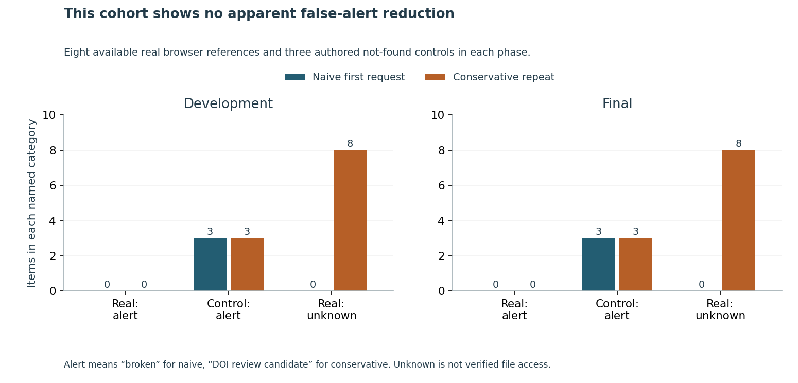

# Check the evidence before reporting a research-data link as broken

A library maintainer needs a review queue that explains what a failed request actually establishes.

**Finding:** this bounded cohort shows **no observed false-alert reduction**. In each phase, both rules flag the same three authored controls and have zero apparent false alerts among eight available browser references. The conservative rule keeps eight repeated empty HTTP 202 responses **unknown**; a matching browser landing page still does not prove dataset-file access.

Use two spaced not-found responses to suggest DOI-routing/metadata review, preserving the original evidence and times. Do not turn a transport problem or an empty accepted response into a claim of permanent data loss. File access, usable data and scientific support require separate checks.

Read the [six-page independent study](paper/manuscript.pdf), inspect [all captured states](data/observations_final_2.json), or run the [offline implementation exercise](IMPLEMENTATION_EXERCISE.md):

~~~sh
python -m pip install -r requirements.txt
python src/triage_cli.py examples/repeated-not-found.json
python src/triage_cli.py examples/accepted-incomplete.json
python src/replay.py --output ../fresh-replay
~~~

The committed examples are authored inputs, not new source observations. The CLI makes no network request or maintainer notification and keeps file availability untested.

## Inspect the evidence

- [Protocol](PROTOCOL.md), [source rights](DATA_RIGHTS.md), [native HTTP binding](NATIVE_HTTP_BINDING.md), [environment](ENVIRONMENT.md) and [execution notes](EXECUTION_NOTES.md).
- One fixed 100-item Crossref metadata response gives 72 candidate relations; 16 DataCite qualification responses yield 16 unique parent/target dataset pairs. Independent native JSON/SQL reconstruction passes 346 conditions. All sixteen actual targets are Karger Figshare; the other permitted prefixes are not evaluated repositories.
- Eight real datasets and three authored controls per phase; 22 items, 44 actual observations and 76 request steps. Both real-time twenty-minute repeat gates pass. [Thirty-seven dependency hashes](data/dependency_freeze.json) were committed before all final landing/reference inspections.
- Agent browser references show eight matching dataset pages and three matching DOI Not Found controls per phase. These later observations are not independent human adjudication or same-instant truth. No download was explicitly opened; automatic browser preview traffic was not audited.
- Native transcript/DOM/time/action/denominator checks pass 741 development and 760 final conditions. All unavailable states and authored controls remain separate from claims about genuine broken scholarly links. The [full actions](results/final/actions.json) and [conditional counts](results/final/summary.json) preserve the negative comparison and eight unknowns.
- Thirty-six fixture methods; three inspected figures with 64 source values, 248 actual SVG coordinates and nine hashes; 41 source-bound manuscript measurements, 228 checks and all six rendered pages. Saved source bodies, receipts and DOM total 922,142 bytes against a 100 MiB budget.

## Reproduce and interpret

Use a full-history clone and a fresh output outside the checkout. Replay recomputes both phase comparisons, runs independent checks, verifies the original freeze and keeps saved source files unchanged. It makes no source request. Private metadata/HTML/DOM originals remain excluded; public replay checks sanitized evidence and the recorded source-verification proof. Inspect the [current review receipt](REVIEW_RECEIPT.json), [pull request](https://github.com/S3R3Bii/research-data-link-triage/pull/2) and [Actions](https://github.com/S3R3Bii/research-data-link-triage/actions) for exact candidate/release evidence.

This is a current, Findable-conditioned metadata slice with a shared publisher, authored controls and a short repeat interval. The twenty-minute bound, fixed rules and lookup/cohort limits are authored assumptions, without model training, calibrated probabilities or optimized timing. There is no measured population error rate, genuine-missing-dataset recall, actual workload reduction, repair, adoption or scientific-claim verification. Separate formal-publication projects, including Azure optimization, remain private.
